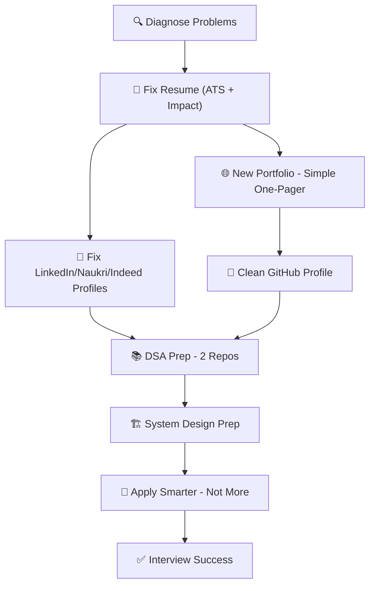

# 🎯 Mahavishnu — Complete Job Search Master Plan

> [!IMPORTANT]
> This is a living document. Update it as you complete each step. The goal is to go from **rejected → selected** by fixing every weak point systematically.

## 🎯 Your Decisions (Locked In)

| Decision | Answer |
|----------|--------|
| **Target Role** | Senior Full-Stack Engineer (PHP/Laravel + React.js primary; FastAPI/AI secondary) |
| **Experience** | 6 years — fully qualifies for Senior |
| **Locations** | Chennai · Bangalore · Coimbatore · Remote |
| **Salary Target** | ₹15 LPA+ |
| **Portfolio** | Brand new repo (separate from current site) |
| **Social Hub** | https://linktr.ee/Mahavishnup — keep updated, add to resume header |

---

## 🔍 Why You're Getting Rejected — Root Cause Analysis

Based on your resume, GitHub, and portfolio, here are the likely real reasons:

### 1. Resume Problems
| Issue | Current State | Problem |
|-------|--------------|---------|
| **Title mismatch** | "Senior Full Stack Engineer \| Laravel, PHP, React.js, TypeScript & FastAPI" | Too long, ATS may truncate; no clear seniority signal for Indian market |
| **Summary is too generic** | "Delivered 20+ production applications..." | Reads like every other dev. No business impact, no numbers-first storytelling |
| **Skills list is scattered** | Backend → Frontend → DB → DevOps → AI | ATS keyword matching fails; no prioritization per job type |
| **Bullet points are task-based** | "Built vehicle monitoring..." | Should be **impact-based**: "Reduced X by Y%, increased Z by N" |
| **Title vs. experience gap** | "Senior" but only 2 companies, ~6 years | Some companies auto-filter if YOE < their threshold for "Senior" |
| **No quantified wins** | Mentioned "25,000+ users, millions of records" only once | Should appear in every bullet |

### 2. Profile / Headline Problems (LinkedIn, Naukri, Indeed)
| Platform | Likely Current Headline | Problem |
|----------|------------------------|---------|
| LinkedIn | "Senior Full Stack Engineer" | Not searchable enough; recruiters search "Laravel Developer" or "React Developer" |
| Naukri | Similar | Should include city/remote preference + salary range + specific keywords |
| Indeed | Similar | Needs ATS-friendly keywords in every section |

**Good headline formula:**
> `[Role] | [Primary Skill] | [Secondary Skill] | [YOE]+ Years | Open to Remote`

Example:
> `Senior Full-Stack Engineer | Laravel + PHP (6Y) | React.js + TypeScript (4Y) | FastAPI + AI | Open to Remote`

### 3. Portfolio Website Problems
- Current site looks hyped (3D effects, complex animations, many pages) — recruiters spend **< 10 seconds** on it
- No **single-page resume view** for recruiters who don't have time
- Projects don't show **what problem was solved** or **what was your role**
- No **"Hire Me" / contact CTA** above the fold
- Blog posts look AI-generated (not hurting, but not helping)

### 4. Interview Preparation Gaps
- DSA/LeetCode: Your background is Laravel/PHP — most companies asking DSA will test **arrays, strings, hashmaps, trees**
- System Design: For Senior roles, expect "Design a URL shortener / booking system / WhatsApp clone"
- Laravel/PHP specific: Design patterns, service container, queues, events
- React: Hooks, state management, performance optimization

### 5. Target Role Confusion
You have too many skills across too many domains. Recruiters don't know what role to put you in:
- Laravel SDE? ✓ Yes
- React Frontend? ✓ Yes
- AI/ML Engineer? Partially ✓
- DevOps? Partially ✓

**Fix: Pick a primary lane → tailor everything for that lane**

---

## 🗺️ The Complete Fix Plan



---

## Phase 1 — Fix Resume (Week 1) 🔴 CRITICAL

### Target: 2 Resume Variants
1. **Laravel/PHP + React — Backend/Fullstack** (primary, for 80% of your applications)
2. **AI/LLM + FastAPI — AI Engineer** (secondary, for AI-focused roles)

### ATS-Optimized Resume Formula (Inspired by the Kriti Jaiswal example you shared)

**Header:** Name | Phone | Email | LinkedIn | GitHub | Portfolio | City, India

**Headline (one line, not a paragraph):**
> Senior Full-Stack Engineer — PHP/Laravel (6Y) · React/TypeScript (4Y) · FastAPI/Python (2Y)

**Professional Summary (3–4 lines max, numbers-first):**
> Full-stack engineer with 6+ years shipping production Laravel/PHP applications and React.js frontends. Built and scaled a tourism booking platform to 25,000+ users processing millions of daily records. Delivered 20+ end-to-end systems across logistics, AI, and e-commerce with cloud/on-prem deployments. Currently building AI agentic workflows (LangChain, RAG, LangGraph) for legal and logistics domains.

**Skills — Group by ATS priority (copy exact job description keywords!):**

```
Languages:    PHP, Python, JavaScript, TypeScript, Bash
Frameworks:   Laravel, FastAPI, React.js, Next.js, Inertia.js, Tailwind CSS
Databases:    MySQL, PostgreSQL, Redis, MongoDB, Qdrant
DevOps:       AWS, DigitalOcean, Docker, Nginx, Linux, CI/CD, Laravel Forge
AI & Tools:   LangChain, LangGraph, RAG, OpenAI API, OCR, RabbitMQ, MCP
```

**Experience Bullets — Before → After Examples:**

| ❌ Before (Task-based) | ✅ After (Impact-based) |
|----------------------|----------------------|
| "Built vehicle monitoring system using Laravel, RabbitMQ, Redis" | "Built real-time vehicle overload detection system processing **2M+ daily records** via RabbitMQ/Redis, reducing manual review time by ~60%" |
| "Scaled a tourism booking platform supporting 25,000+ users" | "Architected and scaled tourism platform from 0 → **25,000+ monthly users** across hotel, ferry, cab, and boat services with 99.9% uptime" |
| "Developed an AI-assisted legal analysis system" | "Built multi-agent legal document analysis system (LangChain + Qdrant + RAG) reducing lawyer research time by ~40%" |
| "Delivered 20+ production applications" | "Delivered **20+ production systems** across 4 years, including booking engines, e-commerce platforms, and business automation tools" |

**Projects Section — Use the Kriti Jaiswal format:**
- Each project: `Name — [Tech Stack] | Date`
- 2–3 bullet points with impact/numbers
- Keep only TOP 3 projects relevant to the job you're applying for

### What to REMOVE from resume
- ❌ "AI coding 1 year" — vague, sounds like you just use Copilot
- ❌ "On-prime server" → fix to "on-premise server"
- ❌ Listing too many tools (Qdrant, FAISS, Pinecone all in same line) — pick 1-2 for each job

---

## 📁 Your Real Projects — Scanned & Analysed

> These are pulled from your actual local codebase. Use these descriptions in resume + portfolio. Ask me to draft individual project deep-dives.

### 🏆 PROJECT 1 — HSWIM (Highway Weigh-In-Motion Enforcement System)
**Path:** `C:\Users\selva\Herd\hswim` · **Status:** Live, Government client  
**Stack:** Laravel 12 · PHP 8.4 · React 19 · Inertia.js v2 · TypeScript · PostgreSQL · Redis · RabbitMQ · MinIO (S3) · CUPS printing · SOAP API · Laravel Horizon · Supervisor · Nginx

> [!CAUTION]
> **DO NOT** mention client name, company name, or government department in any public-facing resume, portfolio, or GitHub. Use "a government road transport authority" only.

**Scale (use this number everywhere — it's your "wow" stat):**
- **10 records/second = ~864,000 records/day = ~26M records/month** processed in real-time
- ⚠️ In resume/portfolio: use **"processes lakhs of vehicle records daily in real-time"** — safe, accurate, impressive

**What it does:** Automated enforcement system for detecting overloaded commercial vehicles at highway WIM sensor stations. Auto-classifies vehicles, calculates overload %, submits legal summons via SOAP API, stores vehicle images in MinIO, and dispatches official PDF notices with retry logic.

**Key Engineering highlights (use in resume bullets):**
- Designed dual-mode ingestion: RabbitMQ real-time + PostgreSQL NOTIFY → polling fallback, **processing 10 records/sec (~26M/month)**
- Built 20-state vehicle workflow engine with structured job failure tracking and dedicated retry queues per failure type
- Integrated SOAP web service for government vehicle/owner registry lookup + automated summon submission
- Implemented exponential backoff retry (10s→20s→30s→60s) for MinIO image readiness before PDF email dispatch
- CUPS-based server-side printing integration for physical enforcement notices
- Government-grade RBAC with 2FA, password history policy, and security question recovery
- Scalable multi-station worker architecture via Laravel Horizon + Supervisor

**Safe resume bullet (copy-paste ready):**
> Built a real-time highway vehicle enforcement system processing **lakhs of records daily** (10 records/sec) using Laravel 12, RabbitMQ, and PostgreSQL NOTIFY triggers. Implemented a 20-state workflow engine with per-failure retry queues, SOAP API integration for vehicle registry, and MinIO-backed PDF summon delivery with exponential backoff.

**Safe portfolio write-up:**
> Engineered a government road enforcement platform that ingests **real-time sensor data from highway weigh stations**, processing lakhs of vehicle records daily at 10 records/sec. Built a 20-state classification engine, automated legal summon generation via SOAP API, MinIO image storage with backoff retry, and physical notice printing via CUPS — all backed by RabbitMQ + Laravel Horizon.

---

### 🏆 PROJECT 2 — SAILaw (Legal AI Research Platform)
**Path:** `C:\Users\selva\Prod\sailaw` · **Status:** Live product (current company)  
**Stack:** FastAPI · Python 3.12 · PostgreSQL async · LangGraph · LangChain · Pinecone · Qdrant · FAISS · MongoDB · Socket.IO · FastMCP · JWT/OAuth2 (Google) · Docker · uv

> [!CAUTION]
> **DO NOT** mention company name. Say "a live legal-tech product at my current company."

**What it does:** Live AI-powered legal research platform. Multi-agent LangGraph chatbot for legal document Q&A, hybrid semantic case search (dense + sparse BM25 vector search), real-time Socket.IO chat, and an MCP server exposing AI tools. Multi-LLM support (OpenAI, Groq, Anthropic, Ollama) with automatic fallback routing.

**Key Engineering highlights:**
- LangGraph multi-agent orchestration with dedicated similarity graph for case retrieval
- Hybrid vector search: Pinecone (dense embeddings) + Qdrant (sparse BM25 fastembed) for precision legal search
- Multi-LLM fallback (`call_llm_with_fallback`) across 6 providers: OpenAI, Groq, Anthropic, Google, OpenRouter, Ollama
- FastMCP server at `/mcp` exposing `search_cases` and `chatbot_query` as AI agent tools
- Full clean Onion Architecture: Domain → Application → Persistence → Presentation, async throughout
- Real-time WebSocket chat (python-socketio) integrated as ASGI middleware around FastAPI

**Safe resume bullet:**
> Built a live AI legal research platform using LangGraph multi-agent orchestration with hybrid vector search (Pinecone + Qdrant BM25). Implemented multi-LLM fallback routing across 6 providers, a FastMCP server for AI agent tooling, and real-time Socket.IO chat — all in FastAPI with clean async Onion Architecture.

---

### 🏆 PROJECT 3 — WhatsApp Loan Q&A Chatbot (Cooperative)
**Path:** `C:\Users\selva\Prod\koperasi_mulia_whatsapp` · **Status:** Live in production  
**Stack:** FastAPI · Python 3.12 · PostgreSQL · Docker · Meta WhatsApp Cloud API · React Admin SPA · Vite · Alembic · pytest

> [!CAUTION]
> **DO NOT** mention cooperative name or company name. Say "a Malaysian financial cooperative."

**What it does:** Live WhatsApp chatbot for a financial cooperative — automates loan FAQ, qualification queries, and member Q&A. Handles escalation to human agents, broadcast messaging via Meta-approved templates, CSAT collection, with an admin React SPA for agent inbox management. Bilingual (Malay/English).

**Key Engineering highlights:**
- Built end-to-end Meta WhatsApp Cloud API integration with HMAC webhook signature verification
- Intent matching → FAQ → loan Q&A → human escalation pipeline
- Admin React SPA with live agent inbox and chat history
- Broadcast pipeline with Meta template management
- CSAT scoring built into conversation flow; pytest-covered webhook parsing and flows

**Safe resume bullet:**
> Built a production WhatsApp chatbot (Meta Cloud API + FastAPI) for a financial cooperative, automating loan FAQ and qualification Q&A with bilingual support, human escalation, broadcast messaging, and CSAT analytics. Includes a React admin SPA for agent inbox management and full pytest test coverage.

---

### 🏆 PROJECT 4 — Loan Approval System (AI-Backed)
**Path:** `C:\Users\selva\Prod\loan-approval-system`  
**Stack:** FastAPI · Python 3.11 · PostgreSQL · SQLAlchemy · OCR pipeline · LangChain · React + TypeScript (frontend) · Docker · GitHub Actions CI/CD · pytest + codecov

**What it does:** Full-stack loan application and approval platform with OCR-based document extraction, AI-driven approval workflows, and a clean Onion Architecture backend.

**Key Engineering highlights:**
- Onion Architecture (Domain → Application → Infrastructure → API) in FastAPI
- OCR pipeline for extracting loan document data (DOCX/PDF classification + extraction)
- GitHub Actions CI/CD with automated test coverage reporting (codecov)
- Dual LLM client factory (`llm_client.py`, `llm_factory.py`) for pluggable AI providers

**Portfolio write-up (draft):**
> Built a loan approval system with **OCR-based document processing** and **AI-driven approval workflows** using FastAPI with Onion Architecture. Includes automated CI/CD via GitHub Actions, test coverage tracking, and a React/TypeScript frontend.

---

### 🏆 PROJECT 5 — Logistics API (Laravel)
**Path:** `C:\Users\selva\Herd\logistics-api`  
**Stack:** Laravel · PHP 8.3 · MySQL · REST API · Spatie Permissions

**What it does:** Laravel REST API for logistics management with RBAC.

---

### 🏆 PROJECT 6 — Tourism & Booking Platform (Previous Company)
**Public GitHub repos:** Several public — use these to demonstrate Laravel scale  
- [`mahavishnup/trytrabby`](https://github.com/mahavishnup/trytrabby) — Main tourism booking platform  
- [`mahavishnup/booking-engine`](https://github.com/mahavishnup/booking-engine) — Core booking engine  
- [`mahavishnup/ferry-booking`](https://github.com/mahavishnup/ferry-booking) — Ferry booking module  
- [`mahavishnup/tour-package-maker`](https://github.com/mahavishnup/tour-package-maker) — Tour package builder  
- [`mahavishnup/escapede`](https://github.com/mahavishnup/escapede) — Multiple branches: Andaman Escapes, Jolly Buoy, Reef Looker, CMS  
**Stack:** Laravel · React.js · Inertia.js · MySQL · Razorpay · AWS · DigitalOcean · Laravel Forge

> [!CAUTION]
> **DO NOT** mention company name (Byrut). Say "a tourism startup in Andaman" or "a travel-tech startup."

**Key numbers to use:** 25,000+ monthly users · 20+ production modules · 4 years · Payment gateway integration  
**Best "scale story"** — always lead with this in Byrut bullets on resume.

**Safe resume bullet:**
> Delivered 20+ production modules for a tourism booking platform serving **25,000+ monthly users** across hotel, ferry, cab, and boat services — built with Laravel, React.js, and MySQL. Integrated Razorpay payment gateway, WhatsApp booking confirmations, and PDF quotation generation. Deployed on AWS + DigitalOcean.

---

### 🔓 Public GitHub Repos (Can Use in Portfolio/README)
| Repo | What to highlight |
|------|------------------|
| [`trytrabby`](https://github.com/mahavishnup/trytrabby) | Tourism platform — Laravel, multi-service booking |
| [`booking-engine`](https://github.com/mahavishnup/booking-engine) | Core booking logic |
| [`ferry-booking`](https://github.com/mahavishnup/ferry-booking) | Laravel module — real world domain |
| [`tour-package-maker`](https://github.com/mahavishnup/tour-package-maker) | PDF quotation + pricing engine |
| [`escapede`](https://github.com/mahavishnup/escapede) (branches) | Multiple client sites — shows versatility |
| [`topprquiz`](https://github.com/mahavishnup/topprquiz) | PHP quiz platform |
| [`NLP-based-chatbot`](https://github.com/mahavishnup/NLP-based-chatbot) | Python NLP — ties to AI background |
| [`face-unlock-webapp`](https://github.com/mahavishnup/face-unlock-webapp) | Face recognition — unique project |
| [`private-and-anonymous-search-engine`](https://github.com/mahavishnup/private-and-anonymous-search-engine) | PHP search engine |
| [`elib`](https://github.com/mahavishnup/elib) | Library system |

**Action items for GitHub:**
1. ⬜ Pin these 6 repos: `trytrabby`, `booking-engine`, `NLP-based-chatbot`, `face-unlock-webapp`, `ferry-booking`, `tour-package-maker`
2. ⬜ Add proper README to each pinned repo (problem statement + tech stack + screenshot)
3. ⬜ Update GitHub profile README — remove old YouTube/blog links, update bio to "Senior Full-Stack Engineer | Laravel · React · FastAPI | Open to work"
4. ⬜ Make sure contribution graph shows recent activity (commit to any repo regularly)

---

---

## Phase 2 — New Simple Portfolio (Week 1–2) 🟡 HIGH

### New Repo: `mahavishnu-portfolio` (brand new, separate from current site)
**Deploy to:** `mahavishnup.github.io` (replace current) OR keep on a subdomain

**Design principle: Recruiters need info in < 30 seconds**

#### One-Page Layout (Top to Bottom)
```
[Hero]          Name + Role + Tagline + CTA buttons (Download CV, Contact)
[About]         4–5 lines, no hype. Real background.
[Skills]        Tech badges grouped by category
[Experience]    Timeline — 2 jobs, key numbers
[Projects]      4–5 REAL projects with: problem solved, your role, stack, result
[Contact]       Email + LinkedIn + GitHub + "Open to Chennai / Bangalore / Remote"
```

> [!TIP]
> **No 3D, no custom cursor, no particle effects, no page transitions.** Simple = trustworthy = fast. Recruiters have 200 tabs open.

#### Tech Choice: Plain HTML + Tailwind CSS CDN (fastest deploy, zero build pipeline)
Or Next.js single page — your call. Build starts once you confirm projects/metrics.

#### Projects to Show (Real — from your actual codebase)
1. **HSWIM** — Government vehicle enforcement system (Laravel 12 + React 19 + PostgreSQL + RabbitMQ + MinIO + SOAP)
2. **SAILaw** — Legal AI research platform (FastAPI + LangGraph + Pinecone + Qdrant + Socket.IO + MCP)
3. **KAMMB WhatsApp Bot** — Production chatbot for cooperative (FastAPI + Meta Cloud API + React Admin SPA)
4. **Loan Approval System** — AI-backed loan processing with OCR pipeline (FastAPI + LangChain + React/TS)
5. **TryTrabby Tourism Suite** — 25,000+ user booking platform (Laravel + React + MySQL + Payment gateways)

**Show 4 of these 5 on portfolio (rotate based on target job type):**
- Targeting Laravel/PHP roles → Show HSWIM + Tourism + Logistics + Loan
- Targeting AI/Full-stack roles → Show SAILaw + KAMMB + Loan + HSWIM

---

## Phase 3 — LinkedIn / Naukri / Indeed Fixes (Week 1) 🔴 CRITICAL

### LinkedIn

**Headline (120 chars max):**
> Senior Full-Stack Engineer | PHP/Laravel · React.js · FastAPI/Python | 6+ Years | Chennai / Bangalore / Remote

**About Section:**
```
I'm a full-stack engineer with 6+ years building production-grade web applications, 
APIs, and AI-powered systems in PHP/Laravel and React.js.

Built a real-time government vehicle enforcement platform processing sensor data 
via RabbitMQ, integrating with a national vehicle registry SOAP API, and automating 
enforcement workflows. Scaled a multi-service tourism booking platform to 25,000+ monthly users 
across hotel, ferry, cab, and boat services.

Currently building AI-agentic legal research systems (LangGraph + Pinecone + FastAPI) 
and production WhatsApp chatbots (Meta Cloud API + FastAPI).

💼 What I bring:
• Laravel/PHP backend APIs and system architecture (6 years)
• React.js + TypeScript SPAs and Next.js SSR applications (4 years)
• FastAPI/Python for AI-backed services — LLMs, OCR, RAG, LangGraph (2 years)
• PostgreSQL/MySQL + Redis at scale
• End-to-end deployment: AWS, DigitalOcean, Docker, Nginx, Supervisor

🔍 Open to: Senior Full-Stack or AI-integrated product roles
📍 Chennai · Bangalore · Coimbatore · Remote
```

**Skills Section:** Add ALL of these (LinkedIn ranks profiles higher with more skills endorsed):
`PHP`, `Laravel`, `React.js`, `TypeScript`, `FastAPI`, `Python`, `PostgreSQL`, `MySQL`, `Redis`, `Docker`, `AWS`, `REST API`, `LangChain`, `Next.js`, `Git`, `Linux`, `Nginx`

**Featured Section:** Add your portfolio link + best project screenshot

### Naukri
- **Headline:** `Senior Full Stack Developer | PHP Laravel React.js FastAPI | 6 Years | Remote`
- **Key Skills:** Must exactly match what companies search (PHP, Laravel, React.js, Node.js, MySQL, PostgreSQL)
- **Expected Salary:** Fill this — profiles without salary range get skipped by some filters
- **Notice Period:** Keep it updated
- **Resume:** Upload ATS-clean PDF (no tables, no columns, no graphics — plain text-parseable)

### Indeed
- Mirror your Naukri headline
- Set job alerts for: "Laravel Developer", "Full Stack PHP Developer", "React Laravel Developer"

---

## Phase 4 — GitHub Profile Cleanup (Week 2) 🟡 HIGH

### Issues with current GitHub profile (`mahavishnup`)
- YouTube video: "React-Native Calculator app" — very junior, outdated
- Blog post: "How to learn React-ui-kit in React Native" — very basic
- These are the FIRST things recruiters see after your profile README

### Fixes
1. **Pin your best 6 repos** — choose ones that show production-level work
2. **Update README** — change YouTube/Blog sections or remove them
3. **Create at least 1 public demo repo** per major project with:
   - Good README with problem statement, architecture diagram, and tech stack
   - Screenshots or demo GIF
4. **Contribution graph** — make sure you're committing regularly (even small docs updates count)

### Suggested Pinned Repos
1. A Laravel + React.js project (your best)
2. A FastAPI + LangChain project
3. A personal utility tool or script (shows initiative)
4. DSA solutions repo (shows you're practicing — link to either prep repo)

---

## Phase 5 — Interview Preparation (Week 2–8) 🟠 MEDIUM

### Repo 1: DSA Patterns
**[Several Coding Patterns for DSA](https://github.com/Chanda-Abdul/Several-Coding-Patterns-for-Solving-Data-Structures-and-Algorithms-Problems-during-Interviews)**

#### Priority patterns for your background (PHP/Laravel → most companies test these):
| Priority | Pattern | Why |
|----------|---------|-----|
| 🔴 Must | Sliding Window | String/Array problems — very common |
| 🔴 Must | Two Pointers | Pairs, palindromes |
| 🔴 Must | HashMap/HashSet | Frequency counting, anagrams |
| 🔴 Must | Binary Search | Sorted array problems |
| 🟡 High | Tree BFS/DFS | JSON parsing, nested structures |
| 🟡 High | Stack/Queue | Balanced brackets, monotonic stack |
| 🟠 Medium | Dynamic Programming | Only if targeting product companies |
| 🟠 Medium | Graphs | Only if targeting FAANG/tier-1 |

**Daily target:** 1–2 LeetCode problems/day using the patterns above

### Repo 2: Company-Wise Problems
**[LeetCode Company-Wise Problems](https://github.com/liquidslr/leetcode-company-wise-problems)**

#### Strategy:
1. Find the companies you're targeting (e.g., Zoho, Freshworks, Razorpay, InMobi, etc.)
2. Practice the company-specific question lists
3. Focus on **Easy + Medium** first — most Indian product companies don't go hard

### System Design Prep (For Senior roles)
Topics to study:
- URL Shortener (classic beginner)
- **Booking System** (directly relevant — you built one!)
- **Chat System** (you built one too — use your experience!)
- Rate Limiting
- Database sharding and replication
- Redis caching strategies
- Message queues (RabbitMQ — you know this!)

> [!TIP]
> For system design, **use your own projects as examples**. "I built a tourism booking system for 25,000 users — here's how I designed it..." is 10x more powerful than a textbook answer.

### Laravel/PHP Deep Dive (Company Specific Tests)
Study these for tech interviews:
- Service Container & Dependency Injection
- Laravel Events & Listeners
- Queue Jobs & Horizon
- Eloquent ORM internals (N+1 problem, eager loading)
- SOLID principles with PHP examples
- Design patterns (Repository, Service, Factory)

---

## Phase 6 — Apply Smarter (Ongoing) 🟢 ONGOING

### Quantity vs. Quality
❌ **Wrong:** Apply to 50 jobs with same resume  
✅ **Right:** Apply to 10 jobs with tailored resumes (change headline + skills to match JD)

### ATS Tips for Each Application
1. **Copy exact keywords from the job description** into your resume/skills
2. **Match your title** to what the company calls the role
3. **Use simple PDF** — no tables, no graphics (ATS can't parse them)
4. **Filename:** `Mahavishnu_Ponnusamy_Senior_Laravel_Developer.pdf` (keyword-rich)

### Target Company Types (₹15 LPA+ in Chennai / Bangalore / Coimbatore / Remote)
| Type | Examples | What they test | Your fit |
|------|---------|---------------|----------|
| **Product SaaS (Chennai)** | Zoho, Freshworks, PayU, Chargebee | DSA + Laravel/PHP depth + System Design | ✅ Strong |
| **Product SaaS (Bangalore)** | Razorpay, BrowserStack, Groww, Postman | DSA + React + System Design | ✅ Strong |
| **AI Startups** | Sarvam AI, Yellow.ai, Haptik, many Series A | FastAPI + LangChain + RAG experience | ✅✅ Very Strong |
| **Mid-size SaaS** | Leadsquared, Wingify, Whatfix, CleverTap | Full-stack depth, Laravel/React | ✅ Strong |
| **Gov/Enterprise IT (GCC)** | Cognizant, HCL, Mphasis GCCs | Your HSWIM government project is a showcase | ✅ Good |
| **Remote (Global)** | Turing, Toptal, Crossover, Arc.dev | Portfolio + Live coding + Strong English | ✅ Good |
| **Startups (Coimbatore)** | Kovai.co, Zoho (Coimbatore office) | Full-stack + product mindset | ✅ Strong |

> [!TIP]
> Your **HSWIM project (government enforcement system)** and **SAILaw (legal AI)** are unique differentiators that most ₹15 LPA candidates don't have. Lead with these in interviews.

### Referrals > Applications
- Connect with 5–10 engineers on LinkedIn who work at target companies
- Ask for referrals — referred candidates have **10x higher** callback rate
- Comment on their posts before DMing (warm up the connection)

---

## 🐙 Phase 4 — GitHub Audit & Strategy (130 Repos Scanned)

> [!IMPORTANT]
> You have **130 repos** total. Most current work is in **private forks** (company repos). You cannot make forks public. Strategy: clean up what's already public + make 1–2 owned private repos public with sanitised READMEs.

### Visibility Breakdown
| Category | Count | Action |
|----------|-------|--------|
| Private forks (company work) | ~35 | ❌ Cannot make public — leave as is |
| Private owned (your personal projects) | ~45 | ✅ Select best 2–3 to sanitise + make public |
| Public (not archived) | ~30 | ✅ Clean up, pin best ones |
| Public archived | ~10 | ⬜ Leave archived, unpin |

---

### 🔓 Public Repos Worth Pinning (Already Public, Not Archived)
Pin these 6 — they show real skill range:

| Repo | Skill shown | Action needed |
|------|-------------|---------------|
| [`face-unlock-webapp`](https://github.com/mahavishnup/face-unlock-webapp) | Face recognition, JS — unique project | Add screenshot to README |
| [`NLP-based-chatbot`](https://github.com/mahavishnup/NLP-based-chatbot) | Python NLP — ties to AI background | Add proper README |
| [`private-and-anonymous-search-engine`](https://github.com/mahavishnup/private-and-anonymous-search-engine) | PHP, privacy, search | Add README |
| [`elib`](https://github.com/mahavishnup/elib) | PHP library system | Add README |
| [`Extractingtext`](https://github.com/mahavishnup/Extractingtext) | PDF/image → text (OCR!) — directly relevant to current AI work | Add proper README linking to AI experience |
| [`inertia-react-ssr-and-filament`](https://github.com/mahavishnup/inertia-react-ssr-and-filament) | Laravel + Inertia + Filament — shows modern Laravel | Add README |

---

### 🔒 Private Owned Repos — Make 2 Public (Sanitised)

> [!CAUTION]
> Before making ANY repo public: remove `.env` files, remove all client names, company names, real API keys, real domain names, and internal URLs. Replace with generic placeholders.

| Repo | What it is | Make public? |
|------|-----------|-------------|
| `ai-search-engine` | Enterprise semantic search (React + FastAPI + RAG) | ✅ YES — after sanitising |
| `booking-engine` | Laravel booking engine (tourism) | ✅ YES — after sanitising + removing client refs |
| `escapede` | Tourism sites (3 live client sites) | ⚠️ CAREFUL — remove client URLs and names first |
| `restaurant-payroll` | Laravel payroll | ⬜ Optional |
| `jewels_b2b` | B2B jewels platform | ⬜ Optional |

**Action for `ai-search-engine`:**
1. Review all files — remove any API keys, client names, company references
2. Write a good README: problem, architecture diagram, tech stack, screenshots
3. Make public → pin to profile
4. This is your **strongest public portfolio proof** for AI roles

---

### ❌ Public Repos to UNPIN / Clean Up
These are public but hurt your profile — too junior, too old:
- `Calculator`, `PHPToDoList`, `PHPOops`, `PHPOOPsCURD`, `PHPMVC` — very basic PHP
- `Sorting-Algorithms`, `Measurement-Converter` — beginner exercises
- `BudgetTrackerPHP`, `QuizPHP` — old
- `AutomaticPasswordGeneratorDjango`, `recipe-app-api-django` — Django tutorials

**Fix:** Don't delete — just make sure they are **NOT pinned** and NOT featured anywhere. Let them exist silently.

---

### 🌐 Linktree (https://linktr.ee/Mahavishnup)
Add to:
- ✅ Resume header (alongside LinkedIn + GitHub + Portfolio)
- ✅ LinkedIn "Website" field
- ✅ Naukri profile
- ✅ Email signature

Make sure Linktree has these links updated:
- Portfolio (new one-pager once built)
- LinkedIn
- GitHub
- Resume PDF download link

---

### 📌 Final GitHub Pinning Strategy (6 slots)
| Slot | Repo | Why |
|------|------|-----|
| 1 | `ai-search-engine` (make public) | Best AI project — semantic search + RAG |
| 2 | `face-unlock-webapp` | Unique — shows creativity + JS |
| 3 | `NLP-based-chatbot` | Python AI — ties to current work |
| 4 | `Extractingtext` | OCR/PDF extraction — directly relevant to current AI/logistics work |
| 5 | `inertia-react-ssr-and-filament` | Modern Laravel stack |
| 6 | `mahavishnup.github.io` | Portfolio site |

---

## Phase 5 — Interview Prep Plan: Basic → Senior 📚

> Use these two repos for DSA:
> - [Coding Patterns](https://github.com/Chanda-Abdul/Several-Coding-Patterns-for-Solving-Data-Structures-and-Algorithms-Problems-during-Interviews)
> - [Company-wise LeetCode](https://github.com/liquidslr/leetcode-company-wise-problems)

### 🟢 Level 1 — Fundamentals (Week 1–2) — For Junior/Mid screening rounds

#### PHP / Laravel Basics (Every company asks these)
| Topic | What to know |
|-------|-------------|
| OOP | Classes, interfaces, abstract, traits, inheritance, polymorphism |
| SOLID | Each principle with a Laravel example |
| Design Patterns | Repository, Service, Factory, Observer, Strategy |
| PHP 8+ Features | Named args, match expression, nullsafe operator, enums, fibers |
| Laravel Core | Service container, DI, facades, service providers |
| Eloquent | N+1 problem, eager loading (`with()`), query scopes, relationships |
| Auth | Sanctum vs Passport, middleware, RBAC |
| Queues | Jobs, workers, Horizon, failed jobs, retry logic |
| Events & Listeners | Difference, use cases, `ShouldQueue` |

**Your cheat code:** You already use ALL of these in HSWIM. Just explain your code in plain English.

#### JavaScript / React Basics
| Topic | What to know |
|-------|-------------|
| JS Fundamentals | Closures, hoisting, event loop, promises, async/await |
| React Hooks | `useState`, `useEffect`, `useRef`, `useMemo`, `useCallback`, custom hooks |
| State Management | Context vs Redux vs Zustand — when to use which |
| Performance | React.memo, lazy loading, code splitting |
| TypeScript | Types vs interfaces, generics, utility types (`Partial`, `Pick`, `Omit`) |

#### Python / FastAPI Basics
| Topic | What to know |
|-------|-------------|
| Async Python | `async/await`, `asyncio`, difference from sync |
| FastAPI | Dependency injection, Pydantic v2, routers, middleware |
| SQLAlchemy | Sessions, relationships, async queries |
| Python OOP | Dataclasses, ABCs, protocols |

---

### 🟡 Level 2 — Mid-Senior Topics (Week 3–4) — For tech interviews

#### Database
| Topic | What to know |
|-------|-------------|
| Indexing | B-Tree vs Hash index, composite indexes, when NOT to index |
| Query Optimization | EXPLAIN ANALYZE, slow queries, covering index |
| Transactions | ACID, isolation levels (read committed vs repeatable read) |
| PostgreSQL | LISTEN/NOTIFY (you use it in HSWIM!), partitioning, CTEs |
| Redis | Cache-aside, write-through, TTL, pub/sub, use cases |
| N+1 | How to detect + fix with eager loading |

#### API Design
| Topic | What to know |
|-------|-------------|
| REST | Resource naming, HTTP verbs, status codes (200/201/400/401/403/404/422/500) |
| Pagination | Cursor vs offset — pros/cons |
| Versioning | `/api/v1/` — why and how |
| Rate Limiting | Token bucket algorithm, Laravel throttle middleware |
| Auth | JWT structure, refresh tokens, OAuth2 flow |
| Webhooks | Signature verification (you did this in KAMMB with HMAC!) |

#### Architecture Patterns
| Topic | What to know |
|-------|-------------|
| Monolith vs Microservices | Trade-offs — when monolith is right |
| CQRS | Command Query Responsibility Segregation |
| Event Sourcing | vs traditional CRUD |
| Onion / Clean Architecture | You used this in loan-approval + sailaw — explain it |
| Message Queues | RabbitMQ vs Redis queue vs Kafka — when to use which (you know RabbitMQ!) |

---

### 🔴 Level 3 — Senior-Specific (Week 5–8) — System Design + Leadership

#### System Design — Use Your Own Projects!
| Design Problem | Your experience to draw from |
|---------------|------------------------------|
| **Real-time data pipeline** | HSWIM — 10 records/sec, dual ingestion, RabbitMQ vs polling |
| **Booking system** | TryTrabby — hotel/ferry/cab, availability, payment, 25K users |
| **WhatsApp/Chat system** | KAMMB bot + SAILaw Socket.IO — webhook, escalation, real-time |
| **Search engine** | ai-search-engine + SAILaw — hybrid vector search, RAG, semantic search |
| **Job queue system** | HSWIM Horizon + RabbitMQ — retry, backoff, failure handling |
| **URL shortener** | Standard — practice this one (you don't have it from experience) |
| **Rate limiter** | Standard — practice algorithm (token bucket, sliding window) |

> [!TIP]
> When asked "design a booking system" — start with: *"I actually built one. Let me walk you through how I designed it, what tradeoffs I made, and what I'd do differently at scale."* This is 10x more powerful than a textbook answer.

#### System Design Framework (Use Every Time)
```
1. Clarify requirements (functional + non-functional)
2. Estimate scale (users, requests/sec, storage)
3. High-level design (draw boxes)
4. Deep dive on 2–3 critical components
5. Identify bottlenecks + solutions (cache, sharding, CDN)
6. Tradeoffs discussion
```

#### Senior Behavioural Questions
| Question type | Your answer material |
|--------------|---------------------|
| "Tell me a time you handled a production issue" | HSWIM retry failures, MinIO image readiness bug |
| "How did you improve system performance?" | RabbitMQ replacing polling, Redis caching, PostgreSQL indexes |
| "How do you handle disagreements with teammates?" | Use a real story |
| "Tell me about your most complex project" | HSWIM — 20 states, SOAP, RabbitMQ, MinIO, government scale |
| "Why Senior at 6 years?" | List specific: led 20+ projects end-to-end, deployed gov systems, scaled to 25K users |

---

### 🧮 DSA Prep Plan (Using the 2 Repos)

**Daily target:** 1 problem/day minimum. 2 on weekends.

#### Priority Patterns (from Coding Patterns repo)
| Week | Pattern | LeetCode Examples |
|------|---------|------------------|
| W1 | Sliding Window | Max subarray, Longest substring without repeat |
| W1 | Two Pointers | Two sum sorted, Remove duplicates |
| W2 | HashMap / HashSet | Two sum, Group anagrams, Top K frequent |
| W2 | Binary Search | Search rotated array, First/last position |
| W3 | Tree BFS | Level order traversal, Min depth |
| W3 | Tree DFS | Path sum, Validate BST |
| W4 | Stack / Queue | Valid parentheses, Daily temperatures |
| W4 | Linked List | Reverse, detect cycle, merge sorted |
| W5+ | Dynamic Programming | Climbing stairs, coin change (only if targeting Zoho/Freshworks) |
| W5+ | Graphs | Only if targeting FAANG/top product |

#### Company-Wise Focus (from Company-wise repo)
| Company | Location | LeetCode difficulty to target |
|---------|----------|------------------------------|
| Zoho | Chennai | Easy + Medium — they have their own MCQ+coding test |
| Freshworks | Chennai | Easy + Medium arrays/strings |
| Chargebee | Chennai | Medium — API design + coding |
| Razorpay | Bangalore | Medium — system design heavy |
| BrowserStack | Bangalore | Medium — coding + architecture |
| Kovai.co | Coimbatore | Easy + Medium — product focused |

#### Zoho Specific (Chennai — Most likely first interview)
Zoho has a unique format — **written test → direct interview**:
1. **Round 1:** MCQ — C, Java, data structures theory (can appear in PHP too)
2. **Round 2:** Coding — 5 programs in 3 hours (arrays, strings, patterns)
3. **Round 3:** Technical interview — explain your code, projects
4. **Round 4:** HR

**Zoho prep must-haves:**
- Pattern printing programs (diamond, triangle, etc.)
- String reversal, palindrome, anagram
- Array sorting without built-ins
- Fibonacci, factorial, prime number
- Linked list operations
- Stack using array

---

## 📊 Progress Tracker (Updated)

### 🔴 Week 1 — Critical (Do These First)
| # | Task | Status |
|---|------|--------|
| 1 | Convert HEIC photo → JPG, upload to LinkedIn | ⬜ TODO |
| 2 | LinkedIn: update headline + about + skills | ⬜ TODO |
| 3 | Naukri: update headline + ₹15L salary + notice period | ⬜ TODO |
| 4 | Indeed: update headline + set job alerts (Laravel, React, Full-Stack PHP) | ⬜ TODO |
| 5 | Linktree (linktr.ee/Mahavishnup): update all links | ⬜ TODO |
| 6 | Resume v1 — Laravel/PHP Senior Full-Stack | ✅ DONE — [`resume-v1-laravel-fullstack.md`](resume-v1-laravel-fullstack.md) — ATS 80+ score, 1 page, Calibri 10pt |
| 7 | Resume v2 — AI/FastAPI Full-Stack variant | ✅ DONE — [`resume-v2-ai-fullstack.md`](resume-v2-ai-fullstack.md) — ATS 75+ score, 1 page, repetition fixed |

### 🟡 Week 2 — High Priority
| # | Task | Status |
|---|------|--------|
| 8 | Sanitise `ai-search-engine` repo → make public → write README | ⬜ TODO |
| 9 | GitHub: unpin all old repos, pin 6 best (listed in Phase 4) | ⬜ TODO |
| 10 | GitHub: update `mahavishnup` profile README | ✅ DONE — pushed to [github.com/mahavishnup](https://github.com/mahavishnup) — Senior headline, open-to-work signal, featured repos table, Linktree added |
| 11 | GitHub: add README + screenshot to each pinned repo | ⬜ TODO |
| 12 | New portfolio repo `mahavishnu-portfolio` built | ✅ DONE — [github.com/mahavishnup/mahavishnu-portfolio](https://github.com/mahavishnup/mahavishnu-portfolio) — live at mahavishnup.github.io/mahavishnu-portfolio — redesigned: dark mode, glassmorphism, terminal hero, animated counters, neon accents (commit 48476b7) |
| 13 | Request 2+ referrals from LinkedIn connections at target companies | ⬜ TODO |

### 🟠 Week 3–4 — Interview Prep Starts
| # | Task | Status |
|---|------|--------|
| 14 | Level 1 prep: PHP/Laravel core concepts (OOP, SOLID, Eloquent, Queues) | ⬜ TODO |
| 15 | Level 1 prep: React Hooks, TypeScript, performance basics | ⬜ TODO |
| 16 | Level 1 prep: FastAPI, async Python, Pydantic | ⬜ TODO |
| 17 | DSA: Sliding Window + Two Pointers (Week 1 pattern) — 10 problems | ⬜ TODO |
| 18 | DSA: HashMap + Binary Search (Week 2 pattern) — 10 problems | ⬜ TODO |
| 19 | 10 tailored job applications sent (match JD keywords in resume) | ⬜ TODO |

### 🟢 Week 5–8 — Senior Level Prep
| # | Task | Status |
|---|------|--------|
| 20 | Level 2 prep: DB indexing, transactions, Redis, query optimization | ⬜ TODO |
| 21 | Level 2 prep: API design, rate limiting, webhooks, auth patterns | ⬜ TODO |
| 22 | Level 3 prep: System Design — Booking System (use TryTrabby story) | ⬜ TODO |
| 23 | Level 3 prep: System Design — Real-time pipeline (use HSWIM story) | ⬜ TODO |
| 24 | Level 3 prep: System Design — Chat/WhatsApp (use KAMMB + SAILaw story) | ⬜ TODO |
| 25 | DSA: Tree BFS/DFS + Stack/Queue — 10 problems | ⬜ TODO |
| 26 | Company-wise: Zoho test prep (pattern programs, string/array basics) | ⬜ TODO |
| 27 | Company-wise: Freshworks/Razorpay medium problems list | ⬜ TODO |
| 28 | Behavioural answers written: production issue, complex project, leadership | ⬜ TODO |

---

---

## ⚡ What to Say to Start Each Phase

| Say this... | I will... |
|------------|-----------|
| `"draft resume"` | Write both ATS resume versions with all real project bullets, ready to copy-paste |
| `"start portfolio"` | Create the new `mahavishnu-portfolio` repo — simple one-page HTML/Tailwind |
| `"update github readme"` | Rewrite your `mahavishnup` profile README — recruiter-ready |
| `"sanitise ai-search-engine"` | Review the repo + write a clean public README without company references |
| `"interview prep [topic]"` | Generate Q&A flashcards for any topic (e.g., "interview prep Laravel queues") |
| `"system design [topic]"` | Walk through a full system design answer using your real experience |

